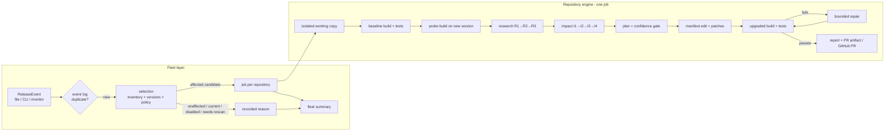

# DepBot

**Fleet-wide, evidence-backed C++ dependency migration.** One upstream release goes in. DepBot works out
which of your registered repositories it actually affects, then migrates each one in an isolated working
copy. It builds and tests every repository for real against the new version, and reports per repository
plus one fleet summary. An LLM is optional and is consulted last, only for what deterministic analysis
could not prove. It never decides an edit on its own.

```text
ReleaseEvent ─► fleet selection ─► per-repository job ─► verified branch + evidence + (optional) GitHub PR
                 (no LLM, no build)  (isolated copy, real install/configure/build/CTest)
```

| What was run for real | Result |
|---|---|
| 517 automated tests (unit + integration + end-to-end with real Conan/CMake/CTest) | all pass or skip with a stated reason (libclang and container-runtime tests skip where those are not installed) |
| Fleet demo: toydep 1.0.0 → 2.0.0 across 3 repos | 2 VERIFIED, 1 SKIPPED (already current) |
| **Real library upgrade: {fmt} 6.2.1 → 7.0.0** built from upstream tags | **VERIFIED**: the `fmt::parse_context` → `fmt::format_parse_context` rename was found in fmt's own changelog, located, patched and verified |
| **Real vcpkg (2026-10-29 release), manifest mode** | **VERIFIED**: `version>=` raised, registry baseline untouched |
| Bounded repair loop | a usage hidden from impact analysis was fixed from compiler diagnostics in 1 attempt; an unfixable case failed honestly |
| Real GitHub pull request | opened on the fork (PR #1), not merged; DepBot never merges |
| 11 repository shapes (lockfiles, CRLF, version ranges, `conanfile.py`, no tests, broken baseline, …) | all 11 give the correct outcome, including safe refusals |
| Live LLM (Gemini) | wiring reached the API; calls failed with provider errors (retired model, then overload); DepBot fell back correctly. **No live LLM answer has been validated yet.** See [Trials](#9-trials-observations-and-what-they-changed). |

---

## Contents

1. [Quick start](#1-quick-start)
2. [Architecture](#2-architecture)
3. [How one repository is upgraded (and why each step exists)](#3-how-one-repository-is-upgraded-and-why-each-step-exists)
4. [Safety model](#4-safety-model)
5. [Code map](#5-code-map)
6. [CLI](#6-cli)
7. [Configuration](#7-configuration)
8. [Tests](#8-tests)
9. [Trials, observations and what they changed](#9-trials-observations-and-what-they-changed)
10. [Limitations and known issues](#10-limitations-and-known-issues)
11. [Repository layout and further docs](#11-repository-layout-and-further-docs)

---

## 1. Quick start

**Requirements:** Python ≥ 3.11, Git, ripgrep (`rg`), CMake ≥ 3.20, a C++17 compiler, and Conan 2 and/or
vcpkg. Optional: libclang 18 for the AST layers (`pip install -e ".[ast]"`), `gh` for `--create-pr`.

```bash
pip install -e ".[dev]"            # add ",ast" for libclang-based analysis
pytest                              # 517 tests; real-tool tests skip if conan/cmake are missing

# Main demo: one release event across a three-repository fleet (offline)
depbot demo setup --fleet examples/demo-fleet.yaml \
  --recipe tests/fixtures/toydep/v1 --recipe tests/fixtures/toydep/v2
depbot fleet status --fleet examples/demo-fleet.yaml
depbot fleet plan   --fleet examples/demo-fleet.yaml --event examples/events/toydep-v2.yaml --approve-major
depbot run          --fleet examples/demo-fleet.yaml --event examples/events/toydep-v2.yaml --approve-major
```

Expected:

```text
Event toydep-v2: toydep 1.0.0 -> 2.0.0
  VERIFIED   repo_a           upgraded install/configure/build/tests passed
  VERIFIED   repo_b           upgraded install/configure/build/tests passed
  SKIPPED    repo_c           already on toydep 2.0.0 (target 2.0.0); no migration needed
considered=3 affected=2 verified=2 skipped=1 failed_or_blocked=0
```

`demo setup` builds the toy library into an isolated, offline Conan home (`examples/.depbot/conan`), so
`~/.conan2` is never touched. toydep 1.0.0 → 2.0.0 is a major upgrade. Without `--approve-major` policy
blocks both repositories, which is a demo of the policy gate in itself. Re-running an event is refused as a
duplicate; `--force` reprocesses it.

Other demos, each with its own runbook:

| Demo | Command / runbook | Shows |
|---|---|---|
| Real {fmt} upgrade | [`examples/real-fmt/README.md`](examples/real-fmt/README.md) | upstream changelog, header diff, AST + probe impact, real patch |
| Real vcpkg | [`examples/real-vcpkg/README.md`](examples/real-vcpkg/README.md) | manifest-mode constraint edit, baseline never moved |
| Repair loop | `depbot run --fleet examples/repair-demo-fleet.yaml --event examples/events/toydep-v2.yaml --approve-major` | compiler-diagnostic repair; honest failure |
| Repository shapes | [`examples/shapes/README.md`](examples/shapes/README.md) | 11 real-world repo shapes, including refusals |
| GitHub PR | `depbot run --fleet examples/github-pr-demo-fleet.yaml --event examples/events/toydep-v2.yaml --approve-major --create-pr` | clone by URL, push branch, open PR |
| LLM on unparseable notes | `depbot run … --event examples/events/toydep-v2-prose.yaml --llm gemini` and `scripts/llm_live_check.py` | R3/I4 only on leftovers |

---

## 2. Architecture

DepBot is two layers with a hard boundary. The **fleet layer** decides *which* repositories need work. The
**repository engine** decides *how* one repository is upgraded. Shared knowledge (the dependency index, the
event log) can make selection faster, but it never replaces a job's own validation.



**Why two layers.** A fleet tool that runs the full migration everywhere wastes builds, LLM calls and
reviewer attention on repositories that don't use the dependency or are already current. Selection is
deterministic and cheap (manifest parsing plus version comparison): `repo_c` in the demo is skipped without
a job, a build or an LLM call. Inside a job, the engine is a plain state machine. Stages are injected
functions that return typed values, so every transition is explicit, recorded and testable.

**Job state machine** (`src/depbot/state.py`). Transitions are validated, and an illegal one raises:

```text
INITIALIZED → INSPECTED → RESEARCHED → IMPACT_ANALYZED → PLANNED → PATCHED → VERIFIED → PR_CREATED
                                                                         └→ NO_CHANGES_NEEDED
failures: BLOCKED (policy/safety/precondition), FAILED_RESEARCH, FAILED_MIGRATION, FAILED_INSTALL,
          FAILED_BUILD, FAILED_TESTS, FAILED_PR
repair:   FAILED_BUILD | FAILED_TESTS → PLANNED, at most max_repair_attempts (≤ 3)
```

Each job ends as a `RepositoryUpgradeOutcome` (`skipped`, `unaffected`, `verified`, `blocked`, `failed`).
`verified` is rejected by validation unless verification really passed. A crash in one job becomes that
repository's `failed` outcome and never stops the rest of the fleet.

**Contracts.** All data crossing a boundary is a Pydantic v2 model with `extra="forbid"`
(`src/depbot/models.py`), from `ReleaseEvent` through `BreakingChange`, `CodeUsage`, `PlannedChange`,
`SourcePatch`, `CommandResult` and `VerificationResult` to `FleetRunSummary`. Unknown fields fail loudly,
which caught several integration mistakes between the three team members' modules early.
[`docs/CONTRACTS.md`](docs/CONTRACTS.md) is the stage-by-stage contract with its change log.

---

## 3. How one repository is upgraded (and why each step exists)

### 3.1 Release events, deduplication and monitoring

A `ReleaseEvent` names the dependency, the upstream repo and the target version, with an optional previous
version and changelog. Events come from a YAML/JSON file (`depbot run --event`), from `depbot upgrade`
(single repository), or from `depbot monitor`. The monitor polls GitHub releases for the configured
`watches` and compares the **lowest** version any enabled repository declares with the latest stable
release. A watch can set a `tag_prefix` for tags like `fmt-11.0.2`. `DEPBOT_GITHUB_TOKEN` (read-only)
raises GitHub's rate limit. It is sent only to `api.github.com` and never on redirects.

The event log (`fleet/events.py`) deduplicates on (dependency, from, to, type). *Why:* release feeds repeat
themselves, and re-running a fleet migration by accident costs builds and could open duplicate PRs.

### 3.2 Selection (`fleet/selection.py`, `fleet/dependency_index.py`)

Every registered repository is classified as one of:
- `affected_candidate`;
- `unaffected` (doesn't use the dependency);
- `already_at_target_or_newer`;
- `disabled`;
- `needs_rescan` (its manifest can't be read safely, e.g. a version range).

Only affected candidates whose policy allows the upgrade become jobs. Every other repository gets a
recorded reason in `selection.json`.

The dependency index caches each repository's scan, keyed by its commit and a manifest digest. The digest
includes a `SCANNER_VERSION`. *Why:* the index makes selection fast, but it is only a candidate filter. The
job re-reads the manifest in its own working copy. The scanner version was added after a real finding: a
parser fix had no effect on repositories whose old refusal was still cached (see §9).

### 3.3 Policy (`policy/engine.py`)

There are three gates, and each records its reasons in the job state and the report:

| Gate | When | Checks |
|---|---|---|
| `pre_migration` | selection | change level (patch/minor/major) allowed; major needs `--approve-major` |
| `plan_confidence` | after planning | every change the migration **relies on** (cited by a planned edit or a definite/possible usage), and every planned edit, has confidence ≥ `minimum_migration_confidence` (0.80) |
| `pre_pr` | before any PR | verification passed and tests actually ran |

`auto_merge: true` is rejected at validation: DepBot never merges. *Why the confidence gate only judges
relied-on changes:* the first real fmt run was blocked by six low-confidence records the repository never
used, such as macro body changes and changelog paragraphs no rule could classify. A real release always has
those. Gating on them would block every real upgrade. Ignoring them silently would hide information. So
they are listed in the decision as "not used by this repository, not gating", and the upgraded build and
tests still have to pass.

### 3.4 Isolated working copy (`repository/worktree.py`, `repository/remote.py`)

The source checkout is only ever read. A job copies the repository into `artifacts/<run_id>/worktree`,
commits a baseline there and works on branch `depbot/<dependency>-<version>`, so `git diff` is exactly
DepBot's change. A Git-root source is cloned locally (history shared, `origin` removed); a subdirectory is
snapshot-copied. A source with uncommitted changes is refused, because the result would depend on state
nobody reviewed.

Repositories can be registered by URL (`https://…`, `ssh://…`, `git@host:owner/repo`). DepBot keeps a clone
in `<state_dir>/sources/<id>-<hash>/` and fetches and resets it on every run. URLs with embedded credentials
are refused. *Why a cache rather than cloning per job:* clones are slow, and the cache keeps network access
in one audited place.

### 3.5 Package managers (`package_managers/`)

Adapters never run commands. They return argv lists and edit manifests. Verification runs the commands.
`detect_adapter` picks Conan (`conanfile.txt`) or vcpkg (`vcpkg.json`), or refuses with a reason.

**Conan 2 (`conan.py`).** `[requires]`, `[tool_requires]` and `[test_requires]` are parsed. Only the
target's reference line changes, and comments and every other byte are preserved, including CRLF line
endings.
- `conanfile.py` is refused: it is executable Python, and its requirements cannot be rewritten safely.
- Version ranges are refused with the specific reason ("pin an exact version first").
- **Lockfiles:** if `conan.lock` exists, only the upgraded package's pins are removed from it, and install
  runs with `--lockfile-partial --lockfile-out`. Every other locked version stays exactly as it was, and
  the rewritten lock is part of the change. *Why:* the lock exists so unrelated packages don't move;
  deleting it would upgrade everything.
- `depbot demo setup` builds operator-supplied recipes into an isolated Conan home with all remotes
  disabled. Only recipes you name are executed, never ones found inside repositories.

**vcpkg manifest mode (`vcpkg.py`).** The resolved version is the maximum of the baseline version and every
`version>=` constraint, unless an `overrides` entry pins it. DepBot raises the target's `version>=` (or its
override) with a byte-minimal JSON edit. It then re-parses the result and checks that it means exactly the
intended change.
- `builtin-baseline` and registry baselines are **never moved.** Moving one silently upgrades every
  dependency in the manifest.
- A dependency pinned only by the baseline is refused with an explanation.
- `VCPKG_ROOT`, the triplets and `VCPKG_FORCE_SYSTEM_BINARIES` (required on ARM Linux, found in the laptop
  trial) are passed through to vcpkg.

### 3.6 Baseline and probe builds

Before any change, the **baseline** (old version) must install, configure, build and pass its tests. If it
doesn't, the job is BLOCKED: a pre-existing failure can't be told apart from a regression. A baseline that
builds but has no tests is reported as exactly that ("has no tests; policy requires tests").

Next, the **probe** builds a scratch copy of the unmodified code against the new version. *Why:* compiler
errors are the most reliable impact evidence available. The probe runs before research, so the research
stage also gets the new version's compile database (needed for the header diff). It is advisory: it never
changes the job status.

### 3.7 Research: what changed (R1 → R2 → R3)

The principle: **settle everything that can be proven deterministically, and give the LLM only what's
left.** Every `BreakingChange` records its `source` (`api_diff`, `changelog_rule`, `llm`) and its evidence.

- **R1, header API diff (`research/header_diff.py`, libclang).**
  - The two compile databases (baseline and probe) give both include-path sets. Directories that differ are
    the upgraded dependency's headers. This works the same for Conan package folders and vcpkg trees.
  - Public declarations are diffed by USR. The diff reports removals, signature changes, newly
    `[[deprecated]]` declarations, removed enumerators, and changed macro bodies (version macros ignored).
    Internal namespaces (`detail`, `internal`, `impl`) and private members are excluded.
  - It records exact USRs (`affected_usrs`) for the impact stage.
  - It **never invents a replacement.** A same-signature newcomer is only mentioned as a candidate in the
    migration advice.
- **R2, changelog rules (`research/breaking_change_analyzer.py`, `changelog_parser.py`).**
  - It reads every changelog section in the version range, not just the target's.
  - It recognises "removes `X`", "renamed `X` to `Y`", "replace with `Y`", and the list-item style real
    projects use: ``- `*parse_context` - replaced by `*format_parse_context` `` (including a replacement
    wrapped onto the next line) and `` `X`: use `Y` instead ``. Those list-item rules were added for
    fmt (§9).
  - Paragraphs that mention breaking, removed, renamed or incompatible, but match no rule, become
    `unknown` changes with confidence 0.20. They are kept, not dropped.
  - Text that looks like instructions (prompt injection) is skipped.
  - A changelog replacement is attached to an R1 removal only if the replacement exists in the new
    headers.
- **R3, LLM (only if a client is configured).**
  - The LLM sees only the leftovers: `unknown` paragraphs, and removals that still have no replacement.
  - Every claim must quote a **verbatim** excerpt of the release text. A claimed replacement must appear
    inside that excerpt; otherwise it is dropped.
  - Findings are *added* and never replace deterministic ones. An `unknown` paragraph counts as explained
    when a concrete LLM finding quotes part of it.

Release text can come from a local file, an HTTPS URL, or a GitHub release page. For a release page, the
exact tag's Markdown body is fetched through the API (`research/release_fetcher.py`, `github_client.py`).
Responses are size-bounded.

### 3.8 Impact: where it hits (I1 → I2 → I3 → I4)

The same principle again. Only **AST- or compiler-proven** usages are edited automatically.

1. **I1 text prefilter (`ripgrep_indexer.py`).** Bounded `rg` over C/C++ sources and headers for each
   affected symbol. Without later layers, only clear call expressions are `definite`. Everything else is
   `possible`.
2. **I2 libclang USR resolution (`clang_analyzer.py`).** Every translation unit of the baseline compile
   database is parsed with the project's own flags. Each text match is resolved to the declaration it
   names:
   - **confirmed:** references, re-declares, or (through a macro body) expands to the changed declaration;
   - **ruled out, with proof:** a same-named entity in another namespace, a comment, or a string literal;
   - **residual:** no AST node in this configuration, e.g. an inactive `#ifdef _WIN32` branch.

   Using-declarations, overload sets and type/template references are handled. Type references are
   spelled qualified in libclang (`fmt::parse_context`); that bug was found and fixed on fmt.
   *Why USRs:* text search can't tell `toydep::old_sum` from `mylib::old_sum`. The
   [spike](docs/spikes/clang_usr_resolution/RESULTS.md) turned 11 text matches into 6 confirmed, 4 ruled
   out and 1 residual, without an LLM.
3. **I3 compiler probe.** A probe-build error at a residual's file and line where the symbol literally
   occurs confirms it (`compiler_probe`). An error no known change explains becomes a new `unknown` usage,
   naming the diagnostic.
4. **I4 LLM (residue only).** It may only answer `possible` or `unaffected` per integer id, never
   `definite` (enforced by model validation). Malformed output is logged and ignored. The LLM can't make
   anything worse.

Layer statistics go to `impact_layers.json`. Without a compile database or libclang, DepBot falls back to
text-only behaviour.

### 3.9 Planning, patching and validation (`migration/`)

- **Planner.** It plans an edit only for a `definite` usage that cites a change with exactly one old symbol,
  one replacement and evidence URLs. Everything else is left for review. Each `PlannedChange` cites its
  change ids.
- **Patch generator.** It produces small deterministic unified diffs: the old symbol becomes the
  replacement as a whole word, on the cited lines only, with the original line endings kept.
- **Validator.** It checks declared paths against the plan or the repository's `allowed_paths`, rejects
  path traversal and stale context, then runs `git apply --check`, applies the patch, and runs
  `git diff --check`. A trailing CR counts as a line ending, not whitespace (a CRLF bug found by the shapes
  corpus). After all patches, a final scope check over everything that changed rejects any file outside
  the plan. The manifest and the adapter's lockfile are exempt from that rule, because they change only
  through the adapter.

### 3.10 Verification (`verification/`)

`run_verification` runs install → CMake configure → build → CTest. It uses the Conan preset when there is
one; it follows `CMakeUserPresets.json` includes and stays inside the worktree.
- Each command runs with an argv list, `shell=False`, a fixed `cwd`, a timeout, and capped logs and tails.
- Commands get a minimal allow-listed environment. No tokens or API keys reach a build.
- A required test suite with zero tests doesn't count as passing.
- `build_configurations` (default `["Release"]`) can add Debug. Every listed configuration must pass, and
  per-configuration evidence goes to `configuration-matrix.json`.
- **Diagnostics** (`diagnostics.py`) parses GCC/Clang, MSVC, CMake and GNU-ld messages into
  repository-relative `CompilerDiagnostic` records.
- **The error classifier** maps a failure to one of: `removed_symbol`, `signature_mismatch`,
  `missing_header`, `linker`, `configuration`, `dependency_install`, `test_regression`, `timeout`,
  `environment`, `compilation` or `unknown`.

### 3.11 Bounded repair (`verification/repair_engine.py`)

A repair is proposed only when the upgraded build's diagnostics report an error that:
- names a symbol whose documented replacement is in the run's evidence, and
- points at a repository line where that symbol literally occurs.

That is a usage impact analysis missed. A typical cause is an unindexed file type, like `calls.inc` in
`repo_d`. The repair becomes an ordinary plan + patch, goes through the same validator, and the full
upgraded verification runs again.
- Attempts are bounded by policy, and an identical diff is never re-applied.
- Configuration, linker and test failures are declined, as are unexplained symbols and token-pasted names
  where the symbol isn't on the reported line (`repo_e`). The job then keeps its honest failure status.
- Repair never runs commands, never edits tests and never invents APIs.

### 3.12 Delivery (`reporting/`)

Every job writes:
- `state.json` (full status history and policy decisions);
- `breaking_changes.json`, `impact.json`, `impact_layers.json`, `api_diff.json` and `plan.json`;
- every patch, plus `final.diff`;
- the command logs;
- `upgrade-report.md`, built only from recorded evidence. Facts that weren't recorded are labelled as such
  ("not run; not recorded"), never assumed.

A verified job also gets a local PR artifact (`pr/pr-body.md`, `pr/pr.json`). The body lists the breaking
changes with evidence links, the affected usages and how each was proven, the changed files, every command
with its exit code and duration, the test counts, the policy reasons, and the limitations.

With `--create-pr`, after the pre-PR gate, the branch is pushed to the source's GitHub `origin` and a PR is
opened via the REST API (`gh api POST repos/{owner}/{repo}/pulls`; GraphQL was unavailable in the
development environment). Local absolute paths are redacted to placeholders (`./`, `<artifacts>`,
`<conan-home>`, `<repo>`, `<depbot>`, `~`), because a published PR must not reveal the runner's
filesystem. The first real PR did.

### 3.13 LLM runtime (`llm/`)

- **Binding.** One client is bound per job through `contextvars` (`llm/runtime.py`). Stages keep their
  fixed signatures and ask for `current_llm_client()`, so a client and its state never leak between jobs.
- **Calls.** Every call is `complete_structured(task, system, user, schema)`. The response must validate
  against a Pydantic schema, or an `LLMError` is raised and the stage keeps its deterministic result.
- **Untrusted text.** Repository and release text is wrapped with `wrap_untrusted()`, and the system prompt
  says that text is data.
- **No tools.** The model is never offered tools, and its output is never executed.
- **Providers:**
  - `fixture`: recorded `{task: response}` JSON, for offline, reproducible tests and demos;
  - `anthropic`: Messages API over stdlib HTTPS, key from `LLM_API_KEY`/`ANTHROPIC_API_KEY`, default model
    `claude-sonnet-5-5`;
  - `gemini`: Gemini Developer API, key from `GEMINI_API_KEY` (sent only in the `x-goog-api-key` header),
    default model `gemini-flash-latest`. Gemini requests use `responseMimeType` + `responseJsonSchema`, with
    the schema's `$defs`/`$ref` inlined.
- **Errors.** A failed call reports Google's error message, truncated and with the key redacted. 429/500/503
  are retried twice (2 s, 5 s); 4xx errors are never retried.
- **Keys.** API keys are never passed to builds, prompts or logs.

---

## 4. Safety model

| Risk | Control |
|---|---|
| Damaging the user's checkout | the source is read-only; work happens in an isolated copy; a dirty source is refused |
| Shell injection, runaway commands | argv-only subprocesses, `shell=False`, fixed `cwd`, timeouts, bounded output |
| Secrets leaking into builds/logs/PRs | allow-listed build environment; tokens only in request headers; local paths redacted from PR bodies |
| LLM hallucinating an API | evidence must be quoted verbatim; replacements must appear in the quote and (with R1) exist in the new headers; an LLM can never make a usage `definite` |
| Prompt injection via changelogs/code | text wrapped as untrusted; instruction-like paragraphs skipped by R2; schema-validated, tool-less responses |
| Over-broad edits | patches only on planned files/lines; final scope check; manifest edited only by the adapter |
| Upgrading unrelated packages | vcpkg baseline never moved; Conan lockfile pins kept except the target; version ranges and `conanfile.py` refused |
| Fake success | `verified` requires real passing install/configure/build/tests; a baseline failure blocks; missing facts reported as missing |
| Untrusted build scripts | opt-in container backend: non-root, no capabilities, read-only root, CPU/memory/PID/time limits, no network, only the job directory writable ([docs/INFRASTRUCTURE.md](docs/INFRASTRUCTURE.md)) |
| Losing or repeating work after a crash | SQLite state with worker leases, stage checkpoints and an idempotency ledger for PRs |
| Runaway repair | bounded attempts, never the same diff twice, no test edits |
| Unreviewed merges | `auto_merge` rejected by the model; PRs are opened, never merged |

---

## 5. Code map

`src/depbot/`. Ownership followed the team split: **A** core/integration,
**B** research and code intelligence, **C** migration, verification and reporting.

| Module | Purpose |
|---|---|
| `models.py`, `state.py`, `interfaces.py` | typed contracts, job state machine, stage protocols and `StageError` |
| `orchestrator.py` | the repository engine: runs one job through all stages; probe; repair loop; delivery |
| `cli.py` | `depbot fleet status/plan`, `run`, `upgrade`, `monitor`, `runs …`, `bench …`, `demo setup` |
| `execution/backend.py`, `local.py`, `container.py` | execution backend contract and per-job context, local processes, hardened Docker/Podman containers |
| `persistence/store.py`, `observer.py` | SQLite store (events, runs, jobs, leases, transitions, artifacts, side effects), job checkpointing and heartbeats |
| `fleet/pool.py` | bounded worker pool and resource-capped worker count |
| `telemetry.py`, `reporting/run_inspect.py` | per-job telemetry document, run inspection and comparison |
| `benchmark/models.py`, `runner.py`, `evaluator.py`, `report.py` | benchmark registry schema, runner, metrics, Markdown report |
| `fleet/registry.py` | fleet YAML (repositories, policies, watches) |
| `fleet/dependency_index.py`, `events.py`, `selection.py`, `runner.py`, `report.py`, `versions.py`, `monitor.py` | inventory cache, event dedup, selection, durable fleet run and resume, fleet summary, version comparison, monitor wiring |
| `monitor/release_monitor.py` | polling of GitHub releases per watch |
| `repository/worktree.py`, `remote.py`, `git_info.py`, `paths.py`, `compile_db.py` | isolated copies, URL repository cache, read-only git queries, path safety, compile-database helpers |
| `package_managers/base.py`, `conan.py`, `conan_setup.py`, `vcpkg.py`, `detector.py` | adapter interface and minimal env, Conan 2, offline Conan home, vcpkg manifest mode, adapter detection |
| `policy/engine.py` | the three policy gates |
| `research/header_diff.py` | R1 header API diff |
| `research/breaking_change_analyzer.py`, `changelog_parser.py`, `release_fetcher.py`, `github_client.py` | R2 rules + R3 orchestration, changelog sections by version range, bounded release retrieval, GitHub REST |
| `code_intelligence/ripgrep_indexer.py`, `symbol_extractor.py`, `clang_analyzer.py`, `impact_analyzer.py` | I1 search, symbol→change mapping, I2 AST resolution, the I1–I4 cascade |
| `clang_support.py` | libclang loading (`$LIBCLANG_PATH`, LLVM 18 locations) and unwrapped C functions |
| `migration/planner.py`, `patch_generator.py`, `patch_validator.py` | recipe-driven plan, recipe-generated diffs with postcondition checks, scoped application |
| `migration/recipes/` | `MigrationRecipe` contract and registry; `symbol-rename`, `header-relocation`; Clang AST extension point |
| `verification/command_runner.py` (dispatches to the execution backend), `pipeline.py`, `diagnostics.py`, `error_classifier.py`, `repair_engine.py` | bounded subprocesses, install/configure/build/test (+ configuration matrix), diagnostics, classification, repair |
| `reporting/evidence_collector.py`, `report_generator.py`, `pull_request.py` | per-repository evidence and report, PR body / publishing |
| `llm/base.py`, `runtime.py`, `provider.py`, `gemini.py` | LLM interface + fixture client, per-job binding, Anthropic and Gemini providers |

`scripts/llm_live_check.py` exercises R3 and I4 against a live provider on inputs the deterministic layers
deliberately can't settle, without needing a build.

---

## 6. CLI

```text
depbot fleet status  --fleet F [--state-dir D] [--json]
depbot fleet plan    --fleet F --event E [--approve-major] [--json]
depbot run           --fleet F --event E [--approve-major] [--force] [--create-pr]
                     [--llm none|fixture|anthropic|gemini] [--llm-fixtures J] [--llm-model M] [--artifacts A]
depbot upgrade       --repo PATH|URL --dependency N --to V [--changelog C] [--upstream-repo O/R]
                     [--base B] [--conan-home H] [--approve-major] [--create-pr] [--llm …]
depbot monitor       --fleet F [--once | --interval SECONDS] [--dry-run] [--approve-major] [--create-pr] [--llm …]
depbot runs          list | show RUN [--job REPO] | compare A B | cancel RUN | resume RUN   --fleet F [--json]
depbot bench         list | run [--split dev|held_out|all] [--case ID] [--out DIR] | hash PATH | report RESULTS
depbot demo setup    --fleet F --recipe DIR [--recipe DIR …]
```

`run`, `upgrade`, `monitor`, `runs resume` and `bench run` also take `--workers N` (not `upgrade`/`bench`) and
`--exec-backend local|docker|podman --exec-image IMAGE [--exec-network none|bridge] [--exec-network-install]
[--exec-cpus N] [--exec-memory-mb N] [--exec-pids N] [--exec-mount-ro PATH] [--exec-mount-rw PATH]`.
See [docs/INFRASTRUCTURE.md](docs/INFRASTRUCTURE.md).

`--state-dir` defaults to `<fleet dir>/.depbot` and holds the index, the SQLite run database (`depbot.db`),
the URL-repository cache and the isolated Conan home. `--llm` can also come from `$DEPBOT_LLM`, and the model from `$DEPBOT_LLM_MODEL`.

---

## 7. Configuration

```yaml
fleet_id: demo-fleet
default_policy_id: demo
policies:
  demo:
    allowed_change_levels: [patch, minor, major]   # default [patch, minor]
    require_human_approval_for_major: true         # needs --approve-major
    require_tests: true
    require_baseline: true
    minimum_migration_confidence: 0.80
    max_repair_attempts: 2                         # 0–3
    run_probe_build: true
    build_configurations: [Release]                # [Release, Debug] for the matrix
    refuse_dirty_worktree: true
    create_pr_on_failure: false
    # auto_merge: true  -> rejected
repositories:
  - repository_id: repo_a
    display_name: Repo A
    repo_url_or_path: ../tests/fixtures/toydep/repositories/repo_a   # path relative to this file, or a Git URL
    default_branch: main        # optional for URLs
    policy_id: demo             # optional
    enabled: true
    allowed_paths: [src]        # optional; default: the files the plan names (+ manifest/lockfile)
watches:                        # for `depbot monitor`
  - dependency_name: fmt
    upstream_repo: fmtlib/fmt
    tag_prefix: ""
```

Release event:

```yaml
event_id: fmt-7.0.0
dependency_name: fmt
upstream_repo: fmtlib/fmt
previous_version: 6.2.1
target_version: 7.0.0
changelog_path: ../.work/ChangeLog-old.md     # or source_url: https://…
```

---

## 8. Tests

**Philosophy.**
- Every module ships with tests, and every bug found in a trial got a regression test.
- Unit tests stub only what they must, mostly external tools; real files, real Git and real parsing
  are used where they're cheap.
- The end-to-end tests run **real Conan, CMake and CTest** against local packages, and they skip,
  never fake-pass, when the tools are missing.
- No test needs the network or an LLM: LLM behaviour is tested with `FixtureLLMClient` and stub
  transports.
- The libclang tests skip without libclang.

```bash
pytest                                   # everything (≈45 s in the container, ≈150 s on the laptop VM)
pytest tests/e2e                         # real-tool end-to-end only
pytest -m "not real_tooling" tests/unit  # pure unit tests
```

517 tests in 50 files (the table below predates the infrastructure suites: execution,
persistence, worker pool, recipes, benchmark, durable-fleet and CLI integration tests):

| Suite | Tests | What it proves |
|---|---:|---|
| **End to end** (`tests/e2e`, real Conan/CMake/CTest) | | |
| `test_toydep_fleet.py` | 1 | one event across the 3-repo fleet with the production stages: 2 verified, 1 skipped, every real command exits 0 in baseline, probe and upgraded phases; `repo_c` never gets a job |
| `test_repair_fleet.py` | 2 | without the probe, `repo_d`'s hidden `.inc` usage is fixed by exactly one repair; `repo_e` (token pasting) fails honestly; with the probe, the hidden usage is caught before planning |
| `test_repo_shapes.py` | 7 | all 11 repository shapes give their expected outcome; lockfile updated and in the change; CRLF preserved; refusals explained; comments/strings untouched |
| **Integration** | | |
| `integration/test_toydep_migration.py` | 1 | plan → patch → apply → real CMake/CTest verification |
| **Engine and contracts** | | |
| `test_orchestrator.py` | 17 | happy path never touches the source, no-usage bump, baseline block, failed tests named, scope and traversal violations, low-confidence plan, crash isolation, re-validation, unintegrated stages, repair success / limit / no repeat / give-up, missing Conan |
| `test_models_and_state.py` | 7 | model validation (e.g. `verified` needs passing verification), legal/illegal transitions |
| `test_impact_cascade.py` | 10 | probe runs before research, compile-database capture, provenance rules (LLM can't be definite) |
| `test_worktree.py` | 14 | isolated copies, dirty refusal, symlink escape, path safety, clone vs snapshot mode |
| `test_remote_repos.py` | 21 | URL validation, credential refusal, cache sync, branch handling |
| `test_fleet_selection.py`, `test_fleet_runner.py`, `test_monitor_wiring.py` | 9 / 5 / 8 | classification reasons, scan-cache invalidation, crash isolation, duplicates, monitor cycles |
| `test_policy_confidence_gate.py` | 4 | relied-on vs unused low-confidence changes (shaped like the real fmt run) |
| **Package managers** | | |
| `test_conan_adapter.py` | 12 | parsing, byte-exact/CRLF edits, ranges and `conanfile.py` refused, lockfile unpinning, install args |
| `test_vcpkg_adapter.py` | 13 | constraint/override edits that keep every other byte, baseline never moved, unpinned refusal, CRLF |
| `test_demo_setup.py` | 4 | minimal env drops secrets, isolated Conan home, non-recipe refused, both versions built |
| **Research** (`unit/research`) | | |
| `test_header_diff.py` | 9 | R1 change kinds, parse errors withhold removals, identical headers, dependency include-dir isolation, replacement confirmed only if it exists |
| `test_breaking_change_analyzer.py`, `test_research_cascade.py` | 10 / 6 | R2 rules including the real fmt 7.0.0 excerpt, version ranges, injection skipping, R3 additive and leftovers-only |
| `test_changelog_parser.py`, `test_release_fetcher.py`, `test_github_client.py`, `test_github_token_and_tags.py` | 15 / 19 / 40 / 3 | section extraction, bounded retrieval, GitHub release lookup, token handling and tag prefixes |
| **Code intelligence** (`unit/code_intelligence`) | | |
| `test_ripgrep_indexer.py`, `test_symbol_extractor.py` | 11 / 6 | bounded search, failures, mapping |
| `test_impact_analyzer.py`, `test_impact_analyzer_fixtures.py`, `test_impact_classification.py` | 12 / 1 / 12 | text verdicts, decoys, I4 id protocol and degradation |
| `test_impact_cascade_layers.py` | 5 | libclang removes false positives, R1 USRs, probe confirms residuals, type-alias references |
| **Migration, verification, repair, delivery** | | |
| `test_migration.py`, `test_patch_validator.py` | 4 / 5 | evidence-gated planning, scope/traversal/stale context, CRLF patches |
| `test_verification_reporting.py`, `test_verification_presets.py`, `test_verification_config_matrix.py`, `test_compiler_diagnostics.py` | 10 / 5 / 3 / 3 | minimal env, build-dir reset, failure mapping, preset includes, Debug/Release matrix, diagnostics parsing |
| `test_repair_engine.py` | 8 | accept/decline rules, never repeats a diff, classifier wording (GCC "has not been declared") |
| `test_pull_request.py` | 10 | evidence-based body, gate, REST publishing, failure notes, path redaction |
| **LLM** | | |
| `test_llm_runtime.py` | 17 | per-job binding, isolation, fixtures, CLI wiring |
| `test_gemini_provider.py` | 16 | request fields, schema inlining, error detail with key redaction, retry on 503/429, no retry on 4xx |
| `test_llm_live_check.py` | 3 | the live-check script with a stub client, including a replacement rejected for missing evidence |
| `monitor/test_release_monitor.py` | 16 | polling, stable-release filtering, failures isolated per watch |

---

## 9. Trials, observations and what they changed

Everything below was actually run. Where something failed, the failure is recorded along with the fix.

### 9.1 Development container (Linux, Conan 2.32, CMake 3.28, GCC 13, libclang 18)

- **Fleet demo.** 2 verified, 1 skipped, in about 9 s.
- **Repair demo, probe off.** `repo_d` went FAILED_BUILD → PLANNED → PATCHED → VERIFIED with
  `src/calls.inc` patched from compiler diagnostics. `repo_e` stayed FAILED_BUILD, "no repair proposed".
  With the probe on, the hidden usage was caught before planning (0 repairs).
- **Real GitHub PR.** The demo service was registered by URL, cloned, migrated, verified, pushed, and
  [PR #1](https://github.com/harsh121205/CrustData-Hackathon---DepBot/pull/1) was opened.
  - *Observation:* `gh pr create` failed because GraphQL was unavailable, so PRs now use REST.
  - *Observation:* the body leaked local absolute paths, so paths are now redacted. PR #1 predates the
    fix.
- **Prose release notes (fixture LLM).**
  - Rules only: the notes say "`old_sum` … is gone; callers should switch to `sum`", which no rule
    parses. The header diff still proves `old_sum` was removed, but no replacement is documented, so
    nothing is patched and the build fails honestly.
  - With recorded LLM answers: both repos VERIFIED.
  - *Observation:* an `unknown` paragraph was only cleared when the LLM quoted the whole paragraph. A real
    model often quotes part of it, which left the job blocked. A partial quote now counts.
- **Debug + Release matrix (B).** Both configurations ran and passed. *Observation:* B's change made both
  configurations mandatory everywhere, doubling build time. It became the opt-in policy field
  `build_configurations`.
- **Repository-shape corpus.** 11 shapes, run with real Conan. The first run found:
  - *Bug:* with a `conan.lock`, install failed because the lock pinned the old version. Fixed with partial
    unpinning.
  - *Bug:* CRLF sources were rejected by `git diff --check`, and the Conan/vcpkg editors normalised CRLF
    to LF. Fixed.
  - *Wrong messages:* a version range said "unrecognised requirement"; a repo with no tests said
    "baseline fails"; manifest-only upgrades read as if nothing happened. Fixed.
  - *Bug:* cached refusals survived a parser fix. Fixed with `SCANNER_VERSION`.

### 9.2 Real {fmt} 6.2.1 → 7.0.0 (Demo B)

A small service with a custom `fmt::formatter<Point>` whose `parse` takes `fmt::parse_context&`, removed in
7.0.0. Building fmt from source was not permitted in the development container. It was checked there with
compile-only runs (6.2.1 compiles with a deprecation warning, 7.0.0 fails at line 14, the patched code
compiles against 7.0.0). It was then run for real on a MacBook (Apple Silicon, in the Claude app's Linux VM):
both fmt releases were built from the upstream tags into an offline Conan home in 31 s.

- **Before running, the fmt case exposed two gaps:**
  - R2 didn't parse fmt's list style (``- `*parse_context` - replaced by `*format_parse_context` ``);
    the list-item rules were added.
  - libclang spells type references qualified (`fmt::parse_context`), so alias uses never matched; fixed.
- **First real run: BLOCKED.** Six low-confidence records the service doesn't use (macro body changes,
  unclassified paragraphs) tripped the confidence gate. This was the most important finding of the
  project: a gate that judges the whole release blocks every real upgrade. The gate now judges only
  relied-on changes (§3.3).
- **Second run: VERIFIED in 28 s.**
  - Baseline passed on 6.2.1.
  - The probe failed with `'fmt::parse_context' has not been declared`.
  - Research found `parse_context → format_parse_context` (0.95, fmt's changelog) and
    `char_type → value_type`.
  - Impact: line 14 definite via the probe, and two comment mentions ruled out by libclang.
  - Patch: `fmt::parse_context&` → `fmt::format_parse_context&` plus `fmt/7.0.0`.
  - The upgraded build and CTest passed.
- *Observation:* the pip `libclang` wheel used on the laptop lacks the compiler's builtin headers
  (`stddef.h` not found), so I2 couldn't confirm line 14 there. The probe did. This is the cascade
  working as designed: when a layer is weaker, the next one catches the case.

### 9.3 Real vcpkg (laptop VM, vcpkg 2026-10-29)

The demo app uses a filesystem registry kept inside the repository: toydep 1.0.0 and 2.0.0, with the
baseline at 1.0.0.

- **Run: VERIFIED in 19 s.**
  - vcpkg install, CMake and CTest passed in the baseline, probe and upgraded phases.
  - The change was exactly `"version>=": "1.0.0"` → `"2.0.0"` and `old_sum` → `sum`.
  - `vcpkg-configuration.json` and the baseline were untouched, and the installed header was the 2.0.0
    one.
- *Observation:* on ARM Linux vcpkg needs `VCPKG_FORCE_SYSTEM_BINARIES=1`, which DepBot's minimal build
  environment stripped. It is now passed through.

### 9.4 Live LLM (Gemini, macOS)

The VM's network allowlist blocks Google's API, so `run-llm-tests` ran in macOS Terminal. Three attempts:

1. HTTP 400 on every call, with no detail, because DepBot discarded the error body. The request used a
   `responseFormat` field. It now uses `responseMimeType` + `responseJsonSchema` and reports Google's error
   message (key redacted).
2. HTTP 404: `gemini-2.5-flash` "is no longer available to new users". The default is now
   `gemini-flash-latest`.
3. HTTP 503 "high demand" on `gemini-3.8-flash`. Bounded retries were added.

In all three, DepBot behaved as designed: it logged the provider error, kept the deterministic findings,
never crashed and never reported a false success. 5 of the 6 live-check assertions passed. The one
expecting the LLM to find `old_sum → sum` failed because no LLM answer arrived. **A successful live LLM
answer is still outstanding** (see §10).

### 9.5 Team-process observations

- Pushing to `main` directly was not allowed at first. Work went through `work/member-*` branches and PRs
  (e.g. #14, #22, #23).
- One GitHub push outage ("fatal error in commit_refs_rules") was worked around with a git bundle.
- Several integration bugs surfaced only when the three members' modules met:
  - C's preset lookup ignored `CMakeUserPresets.json` includes, so Conan builds configured without the
    toolchain;
  - an e2e test expected the probe build to pass;
  - B's LLM impact protocol echoed identity fields back, which blocked jobs; it became an integer-id
    protocol that degrades on bad output.

  The strict `extra="forbid"` contracts and the shared e2e tests are what caught these.

---

## 10. Limitations and known issues

- **The live LLM is not yet validated.** The Gemini integration reached the API, but every attempt hit a
  provider error (§9.4). The deterministic path is fully validated. LLM behaviour is validated only with
  recorded responses.
- **Only renames and documented header moves are migrated automatically.** One old symbol or header →
  one documented replacement, on definite lines. Signature changes, behaviour changes, const-correctness
  requirements (e.g. fmt 11's `formatter::format` must be `const`), header splits where one header becomes
  several (Catch2 v3) and CMake target renames end as an
  honest FAILED_BUILD/FAILED_TESTS (or BLOCKED by the confidence gate), never as a guessed patch.
- **Macros and generated code.** A symbol assembled by token pasting (`toydep::old_##name`) can't be found
  or fixed (`repo_e`). Code in inactive preprocessor branches is only `possible` unless another
  configuration is built.
- **CMake only.** Bazel, Meson and Make are not supported.
- **Conan:** `conanfile.txt` only; `conanfile.py` and version ranges are refused. **vcpkg:** manifest mode
  only; baseline-only pins are refused rather than moving the baseline. CPM/FetchContent and git
  submodules are not handled.
- **One dependency per event.** Coupled upgrades (e.g. spdlog with its bundled fmt) are out of scope.
- **Concurrency is one process.** `--workers N` runs jobs on a bounded thread pool; there are no
  distributed workers. Dependency installs are serialised because the package cache is shared.
- **Container isolation has not been exercised against a real runtime here.** The command DepBot builds,
  its mount policy and its kill/remove behaviour are tested with a recording stand-in for the docker CLI;
  the adversarial tests that run inside a real container (`pytest -m container`) need Docker or Podman
  and an image, and were skipped on the development machine. `git`, ripgrep and libclang still run on the host.
- **The dependency index is still a JSON file.** Events, runs, jobs and telemetry are in SQLite.
- **Benchmark cases are local fixtures.** They run real Conan/CMake/CTest builds, but none is a public
  upstream project at a pinned commit yet; the registry supports that (`repository.url` + `commit`).
- **The AST layers depend on libclang 18 and a compile database.** Without them, impact is text-based and
  only clear calls are definite. A libclang without builtin headers weakens I2 (§9.2).
- **Not run for real:** a public open-source repository fetched from Conan Center (the trials used local
  packages and upstream source builds), Windows/MSVC builds, the Anthropic provider against the live API,
  and `depbot monitor` polling GitHub over a long period (the polling itself is unit-tested).
- **PR #1** predates the path redaction, so its body still contains local paths.

---

## 11. Repository layout and further docs

```text
src/depbot/             the package (see Code map)
tests/unit|integration|e2e   tests/fixtures/toydep: toy library v1/v2 + repo_a…repo_e
examples/
  demo-fleet.yaml, repair-demo-fleet.yaml, github-pr-demo-fleet.yaml, events/
  real-fmt/             Demo B: fmt 6.2.1 → 7.0.0 (app, recipe template, prepare.sh, runbook)
  real-vcpkg/           vcpkg manifest-mode demo with an in-repo filesystem registry
  shapes/               11-shape repository corpus + expected outcomes
benchmarks/
  registry.yaml         versioned benchmark cases with ground truth (dev + held-out)
  fixtures/             geomdep (moved header) and scaledep (behaviour change) packages and apps
  results/              report of a real benchmark run
scripts/llm_live_check.py   live R3/I4 check against a real provider
docs/
  CONTRACTS.md          stage contracts, models and the contract change log
  INFRASTRUCTURE.md     execution backends, durable state and recovery, worker pool, recipes, benchmarks, telemetry
  plan.md               original product plan, priorities (P0/P1/P2) and team split
  instructions.md       engineering, safety and collaboration rules used during development
  spikes/clang_usr_resolution/   the libclang spike that shaped impact layer I2
artifacts/              run output (git-ignored)
```

DepBot was built in a hackathon by a three-person team: core and integration, research and code
intelligence, and migration, verification and reporting. The team used Claude Code as a development tool;
DepBot's runtime doesn't depend on it.
